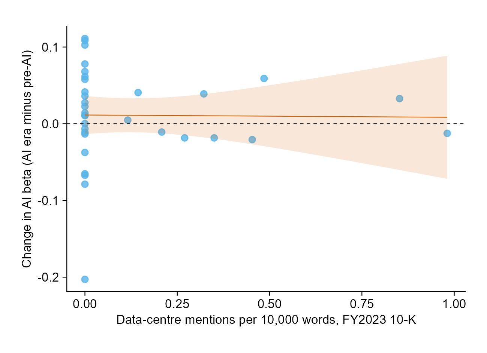
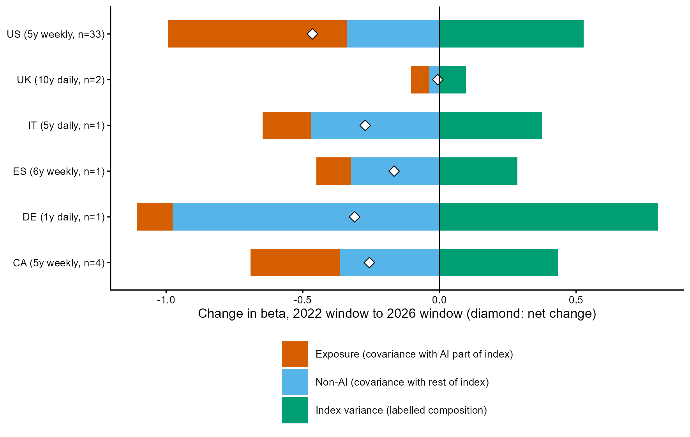
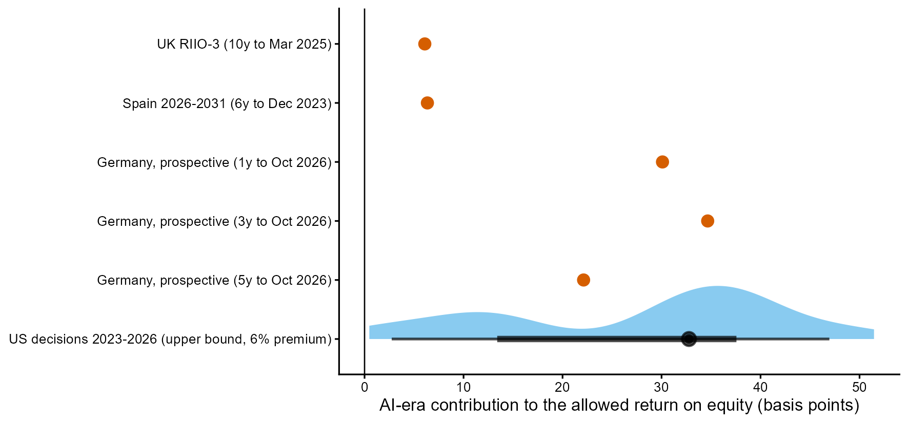
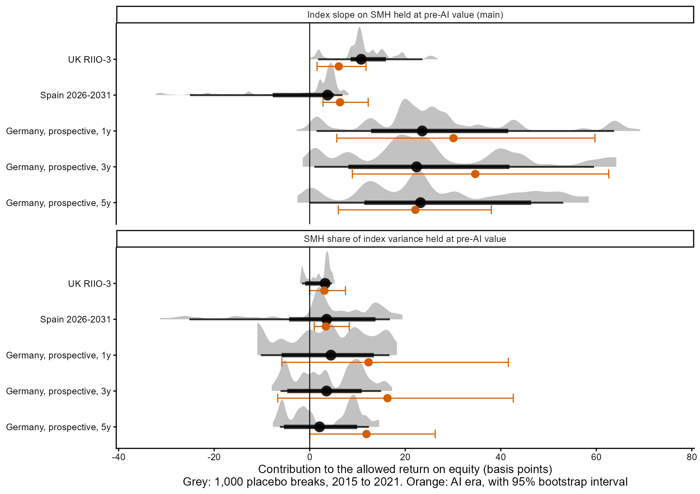

# Does the AI Boom Raise Utilities' Cost of Capital? Evidence across Regulatory Regimes

Regulators set the return that electricity networks may earn on equity, and customers pay it through their bills. Many regulators base that return partly on each utility's measured market risk (beta). This project tests whether the AI investment boom has changed utilities' co-movement with AI stocks and their measured beta, whether any change is concentrated in utilities exposed to data-centre demand, and whether it has reached allowed returns in the US, the UK, Germany, Spain, Italy and Canada.

> **Status:** working paper draft, 8 November 2026: [PDF](paper/ai_utility_cost_of_capital.pdf) ([source](docs/paper.md)). The tests were frozen before any utility returns were analysed ([`docs/prespecification.md`](docs/prespecification.md)); the exposure measure is fixed in [`docs/exposure_rule.md`](docs/exposure_rule.md) and the US rate-case sample in [`docs/ratecase_rule.md`](docs/ratecase_rule.md). Checks added after the first results are dated in [`docs/analysis_notes.md`](docs/analysis_notes.md). Detailed results: [H1 and H2](docs/results_h1_h2.md), [H3 and H4](docs/results_h3_h4.md). Citations, regulatory facts and numbers were checked against their sources on 8 November 2026 ([`docs/verification_log.md`](docs/verification_log.md)).

## Research question

In a CAPM-based determination, the allowed return on equity moves with the beta of listed comparator utilities, measured against a local market index over a recent window. AI could move that beta in two ways: utilities expecting data-centre load could start to trade with AI stocks, and a change in how the market index moves with AI stocks changes every utility's beta against it. Either would reach bills at the next review, whether or not a data centre connects nearby.

## Result 1: exposed utilities did not become more tied to AI stocks

Across 33 US regulated electric utilities, the change in each utility's loading on a semiconductor factor (SMH, orthogonalised to the market) between 2017 to 2022 and 2023 to 2026 shows no detectable relation to data-centre exposure in its FY2023 annual report: the slope is −0.003 per mention per 10,000 words (standard error 0.028; 95% interval about −0.06 to +0.05). In 70% of 1,000 placebo break dates between 2015 and 2021 the slope is at least as large. Regulated utilities load at about −0.28 on the AI factor before 2023 and −0.27 after; merchant generators moved from −0.32 to +0.46.



## Result 2: regulator-style betas fell in five of six countries

Re-estimated on each regulator's own window, average utility betas fell between windows ending in November 2022 and October 2026: by 0.46 in the US (5 years, weekly) and by 0.17 to 0.31 in Germany, Spain, Italy and Canada. The UK's 10-year beta barely moved. An exact decomposition shows lower covariance with both the AI-linked and the other parts of the index, and lower market variance once the 2020 crash leaves the windows.



## Result 3: the AI-era contribution to allowed returns is a few basis points and not specific to the AI era

Rebuilding each regulator's beta with its own comparators, window and de-levering, and recomputing it with AI-era co-movement reset to pre-2023 values, gives +6 basis points for the UK's RIIO-3 (2026 to 2031), +6 for Spain (2026 to 2031) and +22 to +35 for a German estimate made now. Almost all of it comes through the market index; resetting the comparators' own AI loadings changes the betas by at most 0.002.



Two checks written down after the first results, before they ran, qualify these numbers. Holding the semiconductor share of index variance at its pre-AI value, instead of the index's slope on semiconductor returns, roughly halves every contribution: 3 basis points for the UK and Spain, 12 to 16 for Germany, and about zero for the US, where that share did not change. And the contributions are typical of other periods. Placebo break dates between 2015 and 2021, with the same window lengths and positions, give a UK contribution at least as large in 87% of cases and German ones in 26% to 58%; Spain comes closest (5% of 585 usable breaks). The index's slope on semiconductor returns falls after most break dates, because semiconductor volatility rose over the whole sample, so the index channel is not a signature of the AI era.



## Result 4: US rate cases show no pass-through, and the design cannot test it

In 85 US rate decisions, the pre-specified regression of the change in authorised return on equity on the change in the AI-era beta contribution gives 2.65 return points per unit of beta (standard error 1.74, wild-bootstrap p = 0.29 with clustering by state; p = 0.08 with clustering by utility, as the pre-specification named). The regressor is mostly a function of the decision date: the share of the 5-year beta window falling after November 2022 explains 80% of its variation across AI-era decisions, and with fixed effects for the decision year the coefficient is −0.12 (standard error 2.32). The money involved (H4) is small: about £0.27 million a year per £1 billion of UK regulatory asset value, and a median of $12.60 per US customer a year even at full CAPM weight, an upper bound.

Key result tables: [`h1_tests.csv`](output/tables/h1_tests.csv), [`h2_country.csv`](output/tables/h2_country.csv), [`h3_uk_summary.csv`](output/tables/h3_uk_summary.csv), [`h3_es_summary.csv`](output/tables/h3_es_summary.csv), [`h3_de_summary.csv`](output/tables/h3_de_summary.csv), [`h3_us_panel.csv`](output/tables/h3_us_panel.csv), [`h3_robustness.csv`](output/tables/h3_robustness.csv), [`h3_further_uncertainty.csv`](output/tables/h3_further_uncertainty.csv), [`h3_further_us_timing.csv`](output/tables/h3_further_us_timing.csv), [`h4_us.csv`](output/tables/h4_us.csv).

## Reproducing

Requires Python 3.10 or later, and R 4.3 or later with `tidyplots`, `ggdist`, `distributional`, `dplyr`, `readr` and `tidyr` for the figures. The Word and PDF versions of the paper are built with Microsoft Word through COM (Windows only; skipped elsewhere).

```bash
pip install -r requirements.txt
python run_all.py
```

Stages 02, 03 and 07 read SEC filings (stage 07 reads them in memory and keeps only the extracted sentences), and SEC requires a contact in each request: set the environment variable `SEC_USER_AGENT` (for example "Your Name your@email") first. Without it, `run_all.py` skips those stages and reuses the committed tables. If `Rscript` is not on PATH, set `RSCRIPT` to its location. Every dataset gathered is documented, with sources, in `data/project_data_workbook.xlsx`.

## Repository layout

```
.
├── run_all.py
├── paper/ai_utility_cost_of_capital.pdf   # working paper (built from docs/paper.md)
├── code/
│   ├── config.py                    # dates, market indices, AI factors, FX
│   ├── 01_download_prices.py
│   ├── 02_collect_dc_disclosures.py # SEC filings mentioning data centres
│   ├── 03_dc_exposure_measures.py   # exposure measures, FY2023 and FY2024
│   ├── 05_download_rates.py         # national 10-year government bond yields
│   ├── 06_select_ratecase_units.py  # one US rate unit per holding company (EIA-861)
│   ├── 07_extract_ratecase_sentences.py # ROE sentences from 10-K and 10-Q filings (read in memory)
│   ├── 08_ratecase_candidates.py    # candidate decisions per unit (unverified reading aid)
│   ├── 09_build_workbook.py         # documented Excel workbook of all data
│   ├── 10_ratecase_second_pass.py   # re-checks each coded decision against its source
│   ├── 11_rate_base_proxy.py        # FERC Form 1 net plant per US rate unit (H4)
│   ├── 12_returns.py                # daily and weekly returns and factors
│   ├── 13_placebo_exposure.py       # FY2023 exposure for US water and gas placebos
│   ├── 14_h1_comovement.py          # H1 tests, placebo breaks, robustness
│   ├── 15_h2_decomposition.py       # H2 beta decomposition
│   ├── 16_figures.R                 # figures (tidyplots, ggdist)
│   ├── 17_h3_replicas.py            # UK, Germany, Spain replicas and counterfactuals
│   ├── 18_h3_us_panel.py            # US rate-case panel and H4
│   ├── 19_h3_robustness.py          # pre-specified H3 robustness checks
│   ├── 20_h3_further_checks.py      # alternative counterfactual, bootstrap, placebo breaks, US timing
│   └── 21_build_paper.py            # Word and PDF versions of docs/paper.md
├── data/
│   ├── project_data_workbook.xlsx   # every dataset gathered, with sources
│   ├── classification/              # utilities, regulator methods and parameters
│   ├── raw/                         # downloads (not committed)
│   └── derived/
├── output/{tables,figures}/
└── docs/                            # design, pre-specification, rules, notes, results, paper source
```

## Author and license

Arian Nasrollahi Shiraz. A research project on electricity regulation and finance. It is a research artifact, not a peer-reviewed publication.

Code is released under the [MIT License](LICENSE). Downloaded data are not redistributed and remain subject to their providers' terms.
