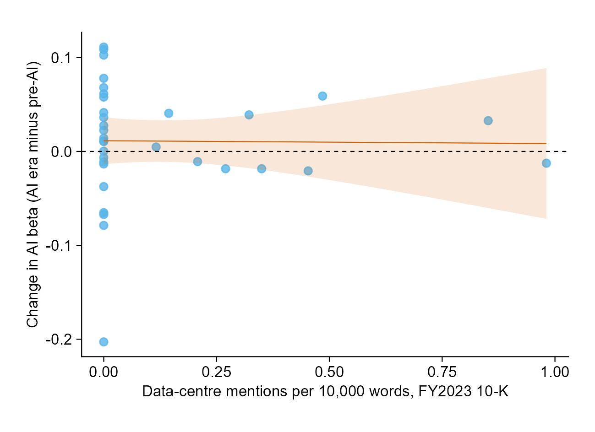
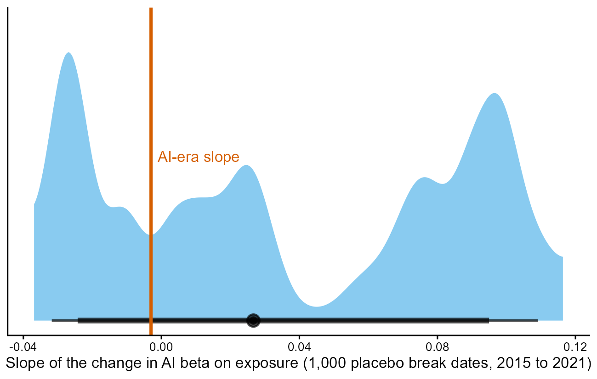
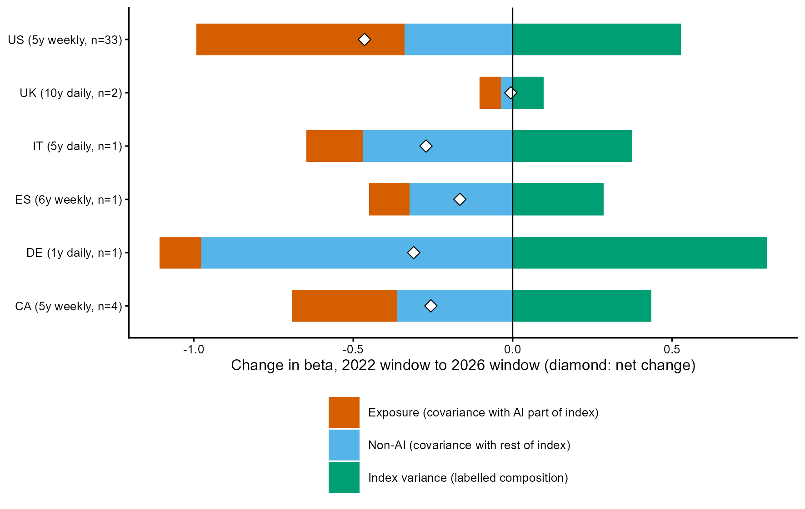
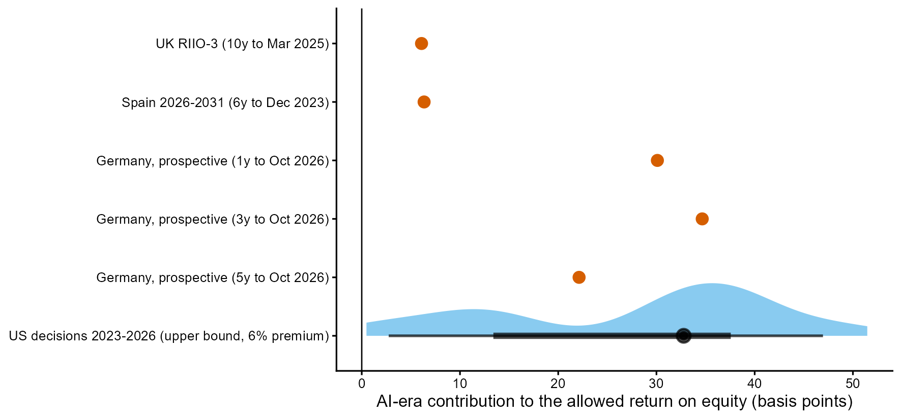

# AI Stocks, Utility Betas and Allowed Returns: Evidence from Six Regulatory Regimes

Arian Nasrollahi Shiraz

Working draft, 8 November 2026. All numbers come from the scripts in `code/` and the tables in `output/tables/`; the tests were written down in [prespecification.md](prespecification.md) before any utility returns were analysed.

## Abstract

Regulators set utilities' allowed return on equity partly from market betas, so a change in how utility shares move with AI stocks could reach electricity bills. I test this channel for 33 US regulated electric utilities and for regulated networks in five other countries, with tests fixed in advance. Utilities that disclose more data-centre activity did not become more correlated with semiconductor stocks after November 2022 (slope −0.003, standard error 0.028). I then rebuild each regulator's beta and recompute it with AI-era co-movement held at its pre-2023 level. The AI era adds 6 basis points to the UK's 2026 to 2031 allowed return, 6 to Spain's and 22 to 35 to a prospective German estimate. Almost none of this comes from utilities' own AI exposure; it comes from the market index moving less with chip stocks. In 85 US rate cases, pass-through is not distinguishable from zero.

## 1. Introduction

The allowed return on equity is one of the largest single parameters in a network bill. Dunkle Werner and Jarvis (2025) estimate that US allowed returns above the cost of capital cost consumers about $7 billion a year, and Rode and Fischbeck (2019) document a premium of allowed returns over benchmarks that has grown for decades. In most of the regimes studied here, part of the allowed return comes from the capital asset pricing model (CAPM): the regulator measures how much the shares of comparable listed utilities move with the market (their beta) over a recent window and multiplies it by a market risk premium. Anything that changes measured betas therefore changes allowed returns at the next review, and customers pay the difference whether or not a data centre connects near them.

The AI investment boom could move these betas in two ways. Utilities that expect large data-centre loads might start to trade with AI stocks, which would raise their covariance with the market. And because betas are measured against a local index, a change in how much that index moves with AI stocks changes the beta of any utility whose own AI co-movement differs from the market's. This paper asks whether either channel has reached measured betas since 30 November 2022, and whether it has reached allowed returns.

The answer is that the financial channel from AI to allowed returns exists but is small, and it does not run through utilities' own exposure. Across the 33 US regulated electric utilities, the change in each utility's loading on an AI factor between 2017 to 2022 and 2023 to 2026 is unrelated to its data-centre exposure: the slope is −0.003 per data-centre mention per 10,000 words of the annual report (standard error 0.028), and 70% of 1,000 placebo break dates give a slope at least as large. Regulated utilities load negatively on the AI factor once the market is held fixed, about −0.27 in both periods. Merchant generators moved from −0.32 to +0.46, consistent with investors pricing AI demand into generators that sell power at market prices.

Regulator-style betas fell between windows ending in November 2022 and windows ending in October 2026 in five of the six countries: in the US by 0.46 on a 5-year weekly window, and by 0.17 to 0.31 in Germany, Spain, Italy and Canada. The UK's 10-year beta barely moved. An exact decomposition shows that utilities co-moved less with both the AI-linked and the other parts of the index, while the third term mainly records lower market variance once the 2020 crash leaves the window.

To measure what AI-era co-movement contributed to actual decisions, I rebuild each regulator's beta with its own comparators, window, return frequency and de-levering, then recompute it with AI-era returns put back on their pre-AI footing. The AI era adds 0.006 to the asset beta behind the UK's RIIO-3 determination, or 6 basis points on the allowed return on equity. It adds 6 basis points in Spain and 22 to 35 basis points to a German estimate made in October 2026 for the next electricity period. Putting each comparator's own AI loading back at its pre-AI value changes these betas by at most 0.002. Almost the whole contribution comes from the market index: in the AI era the index moved less with semiconductor stocks per unit of their return (for the S&P 500, the slope fell from 0.47 to 0.34), and since utilities move against the AI factor, a market less driven by chip stocks makes them look slightly riskier relative to it. The size of the effect follows how much AI-era data each regulator's window contains, from 1 of 6 years in Spain to nearly all of a German 1-year or 3-year window.

In 85 US rate decisions, I rebuild at each order date the Value Line-style beta common in rate-case testimony. The pre-specified regression of the change in authorised return on equity on the change in the AI-era contribution gives a coefficient of 2.65 return points per unit of beta (standard error 1.74, wild-bootstrap p = 0.29). The estimate is not significant in any of the pre-specified checks, and the design cannot separate it from any post-2022 shift in allowed returns that interest rates and credit spreads miss. The money involved is small: about £0.27 million a year per £1 billion of UK regulatory asset value, and a median of $5.60 per US customer a year at the estimated coefficient ($12.60 at full CAPM weight, an upper bound).

This paper relates to three literatures. Work on rate-of-return regulation (Rode and Fischbeck 2019; Dunkle Werner and Jarvis 2025) studies how allowed returns track the cost of capital, but treats the inputs regulators use as given. Van Nieuwerburgh (2026) estimates rolling betas for data-centre real estate during the AI buildout, but does not study utilities or rate cases. A companion event study (Nasrollahi Shiraz 2026) finds that on 27 January 2025, when DeepSeek's R1 model raised doubts about AI electricity demand, merchant generators fell about 19% and ended 20.5 points below regulated electric utilities. Searches of the web and Google Scholar on 7 November 2026 found no study linking AI exposure to utilities' measured betas or allowed returns. Relative to this work, the paper makes three contributions. It measures the AI-era component of the betas that actual determinations used, rather than of a generic beta. It separates the utilities' own AI exposure from the composition of the index, which turns out to carry almost all of the effect. And it traces the effect across borders through regulators' foreign comparators: 2.5 of the UK's 6 basis points come from Spanish and Italian networks.

Section 2 describes how each regulator uses beta. Section 3 describes the data, Section 4 the tests and Section 5 the results. Section 6 reports the pre-specified checks, Section 7 what the results do not show, and Section 8 concludes.

## 2. How regulators use beta

A regulator using the CAPM sets the cost of equity as r_e = r_f + β_e × MRP, where r_f is the risk-free rate, MRP the market risk premium and β_e an equity beta. Because comparators carry different debt loads, regulators first convert each comparator's measured equity beta into an asset beta (the beta of the business with no debt), average the asset betas, and convert the average back to an equity beta at a notional gearing. This step is called de-levering and re-levering. The return on equity therefore responds to a change in comparator betas in proportion to the premium and inversely to the notional equity share.

Table 1 summarises the determinations in scope. All values come from the regulators' own documents, with page references in [regulator_methods.md](regulator_methods.md), except the US and Canadian rows, which rest on company filings and secondary sources.

**Table 1. Beta in six regulatory regimes**

| | Decision | Comparators | Window and frequency | Adjustment and de-levering | Published value |
|---|---|---|---|---|---|
| UK | Ofgem RIIO-3 Final Determinations, December 2025 (2026 to 2031) | Nine: three UK water companies, National Grid, and five Spanish and Italian networks | 10 years, daily (2 and 5 years shown) | No adjustment; Harris and Pringle (1985) de-levering, debt beta 0.075, notional gearing 55% for electricity | Asset beta 0.375; MRP 4.6% (CPIH-real) |
| Spain | CNMC Circular 9/2025, December 2025 (2026 to 2031) | 34 European utilities | 6 years to December 2023, weekly | Modigliani-Miller unlevering, Hamada (1972) re-levering, gearing 46% | Equity beta 0.75; MRP 4.98% |
| Germany | BNetzA; next electricity period from 2029 | Foreign network operators; twelve in the July 2026 expert report | 1, 3 and 5 years, daily, most weight on 1 year | Vasicek (1973) adjustment | Prospective only |
| Italy | ARERA Delibera 513/2024, November 2024 (2025 to 2027) | Comparators in similar sectors, liquidity filter | 5 years (2019 to 2023), daily | Blume (1971), Hamada | Asset betas 0.370 and 0.400, unchanged from 2022 to 2024 |
| US | State commission rate cases | Proxy groups of US utilities | Value Line: 5 years, weekly | Blume: 0.67 × raw beta + 0.33 | Case by case; CAPM is one of several models |
| Canada | OEB and AUC formulas | None | None | None | Return tied to bond yields; no beta |

Two features of Table 1 shape the tests. First, regimes differ in how much AI-era data their betas can absorb: Spain's window contains one AI-era year out of six, the UK's about 2.3 out of 10, and Canada's formula contains no beta at all. Second, comparator sets cross borders, so a change in Spanish or Italian network betas can move the UK's allowed return.

## 3. Data

**Prices.** Daily adjusted closing prices from Yahoo Finance for 2 January 2012 to 6 November 2026: 33 US regulated electric utilities, National Grid and SSE (UK), E.ON (Germany), Redeia (Spain), Terna (Italy), four Canadian utilities, US water and gas utilities as placebos, two merchant generators, each regulator's comparators, the local market indices, the VanEck semiconductor ETF (SMH), Nvidia and exchange rates. Returns are log returns in local currency.

**Interest rates.** Daily 10-year government yields from FRED, the Bank of England, the Bundesbank, the Banco de España and the Bank of Canada; for Italy, the ECB's euro-area series (no official daily Italian series was found). The US Baa corporate spread over the 10-year Treasury (FRED BAA10Y) is the credit-spread control in the rate-case panel.

**Data-centre exposure.** For US utilities, mentions of data centres per 10,000 words of the main text of the FY2023 10-K, counted under a rule frozen before any returns were analysed ([exposure_rule.md](exposure_rule.md)). The most exposed utility has 0.98 mentions per 10,000 words. Outside the US, where no country-level data-centre share of demand is published for these five countries, exposure is an indicator for utilities serving a major data-centre hub.

**Rate cases.** For each of the 33 US utilities, the rate unit is the operating company and state with the largest 2023 retail deliveries in EIA Form 861, under a rule frozen in advance ([ratecase_rule.md](ratecase_rule.md)). Authorised returns on equity, order dates and equity ratios were coded from the utilities' SEC filings: 109 decisions between 2014 and 2026, of which 85 enter the panel. The others are excluded under written conventions (rehearings, formula-rate and plan updates, rate freezes, settlements that state no return, a return set by statute) or still pending ([ratecase_coding_notes.md](ratecase_coding_notes.md)). Every coded decision was checked by hand against the source sentence; 9 of the 104 checked decisions were corrected, three of them in the return itself and the rest in dates or equity ratios. The panel covers 32 utilities in 24 states; 53 pairs of consecutive decisions in 18 states identify the panel regression. Mean authorised returns are 9.78% for decisions before 2023 and 9.70% from 2023 on.

**Rate base and customers.** Stated rate base where a filing gives it (six units); otherwise net electric plant from FERC Form 1, through the PUDL database, which overstates stated rate base by about 1.2 to 2.7 times where both exist and is used as an upper bound. Customers are 2023 counts from EIA Form 861.

**Regulator inputs.** Comparator betas from Ofgem's Draft Determinations (Table 16), the CNMC's explanatory memorandum and the July 2026 expert report for BNetzA (Frontier Economics, Table 3); parameters from the final decisions. Raw downloads are archived with SHA-256 checksums, and every dataset is documented in a script-built workbook (`data/project_data_workbook.xlsx`).

## 4. Tests

All tests below were frozen on 7 November 2026, before utility returns were analysed. Three amendments, logged with dates and reasons in the pre-specification, replaced unavailable inputs (the Italian yield series, a country-level exposure share and utility bond spreads); later implementation choices are dated in [analysis_notes.md](analysis_notes.md).

**AI co-movement (H1).** For each utility, I estimate on daily returns

$$r_{u,t} = a + b_m m_t + b_{ai}\, ai^{\perp}_t + b_r \Delta y_t + e_t,$$

where m is the local index return, ai⊥ is the SMH return in local currency orthogonalised to the index within the window, and Δy the change in the 10-year yield. The pre-AI period runs from January 2017 to November 2022 without February to June 2020; the AI era from January 2023 to October 2026. The test regresses the change in b_ai across the 33 US utilities on data-centre exposure. A positive slope would mean exposed utilities became more tied to AI stocks.

**Beta decomposition (H2).** With C = cov(u, m) split into C_ai, the covariance with the part of the index explained by SMH, and C_o, the rest, and V = var(m), the change in beta between windows a and b is exactly

$$\Delta\beta = \frac{\Delta C_{ai}}{V_b} + \frac{\Delta C_o}{V_b} + C_a\left(\frac{1}{V_b} - \frac{1}{V_a}\right).$$

The first term is the exposure channel, the second the non-AI channel, and the third reflects the index's variance. Each country's beta is computed in its regulator's window and frequency, ending 29 November 2022 and 31 October 2026.

**Counterfactual replicas (H3).** For each determination, I reproduce the regulator's beta and then recompute it with two counterfactual changes on AI-era dates:

- exposure: each comparator's return becomes $r - (b_{ai}^{AI} - b_{ai}^{pre})\, ai^{\perp}$, which puts its AI loading back at its pre-AI value;
- composition: the index return becomes $m - (g^{AI} - g^{pre})\, smh$, where g is the slope of the index on SMH, which puts the index's co-movement with chip stocks back at its pre-AI value.

The AI-era contribution is the replica beta minus the counterfactual beta with both changes, re-levered at the regulator's notional gearing and multiplied by its premium, in basis points of allowed return on equity. For the UK and Germany, each comparator's gearing is backed out from the regulator's own published asset beta and my equity beta, and held fixed in the counterfactual; the check on the replica is whether the implied gearing is plausible (between 0.2 and 0.75). For Spain, the check compares my levered betas with the CNMC's.

**US panel.** At each decision date, I compute each utility's Blume-adjusted beta on 5 years of weekly returns against the S&P 500, and the same beta under the counterfactual; their difference c is the AI-era contribution. For consecutive decisions k − 1 and k of unit u in state s,

$$\Delta ROE_{u,k} = \alpha_s + \theta\, \Delta c_{u,k} + \gamma_1 \Delta y^{10}_{u,k} + \gamma_2 \Delta baa_{u,k} + \varepsilon_{u,k},$$

with the 10-year Treasury yield and the Baa spread averaged over the 30 days before each order. Standard errors are clustered by state, and p-values come from a wild cluster bootstrap with Webb (2023) weights. H3 predicts θ between zero and the market risk premium (about 6 points per unit of beta), because commissions weight the CAPM only partly; New York, for example, gives it one third.

**Money (H4).** Basis points times the equity share of the regulated asset base, per year and per customer.

## 5. Results

### 5.1 Exposed utilities did not become more tied to AI stocks

Figure 1 plots the change in each US utility's AI loading against its exposure. The slope is −0.003 (standard error 0.028); the fitted gap between the most exposed utility and one with no mentions is about −0.003, against a cross-utility standard deviation of the change of about 0.06. The 95% confidence interval runs from about −0.06 to +0.05. In 70% of 1,000 placebo break dates between 2015 and 2021 the slope is at least as large (Figure 2); neighbouring dates share most of their windows, so this is a rank among a few distinct periods rather than 1,000 independent draws. US water and gas utilities, none of which mention data centres, moved like unexposed electric utilities (placebo indicator −0.016, standard error 0.036). Pooling all six countries with exposure standardised within each gives a slope of −0.0015 (wild-bootstrap p = 0.28, six clusters).

*Figure 1. Change in AI-factor loading (2023 to 2026 minus 2017 to 2022) against FY2023 data-centre mentions per 10,000 words, 33 US regulated electric utilities.*

*Figure 2. Exposure slope at 1,000 placebo break dates between 2015 and 2021, against the AI-era slope.*

The levels say more than the changes. Regulated utilities load at about −0.27 on the AI factor in both periods: with the market held fixed, they rise when chip stocks fall. Merchant generators (Vistra and Constellation) moved from −0.32 to +0.46. Returns alone cannot show why, but the pattern fits investors pricing AI demand into generators that sell at market prices, and the regulated utilities that disclose the most data-centre activity show it as clearly as the rest.

### 5.2 Regulator-style betas fell

**Table 2. Average beta of regulated electric utilities in each regulator's window**

| Country | Window | Utilities | Window to November 2022 | Window to October 2026 | Change |
|---|---|---|---|---|---|
| US | 5 years, weekly | 33 | 0.82 | 0.36 | −0.46 |
| UK | 10 years, daily | 2 | 0.76 | 0.76 | −0.01 |
| Germany | 1 year, daily | 1 | 0.71 | 0.40 | −0.31 |
| Spain | 6 years, weekly | 1 | 0.50 | 0.33 | −0.17 |
| Italy | 5 years, daily | 1 | 0.63 | 0.35 | −0.27 |
| Canada | 5 years, weekly (descriptive) | 4 | 0.60 | 0.35 | −0.26 |

Table 2 shows that a regulator re-estimating beta in 2026 on its usual window would find a lower beta than in 2022 everywhere except the UK, whose 10-year window barely moved. Figure 3 splits each change into the three terms of the decomposition. The exposure and non-AI terms are negative in every country: utilities co-moved less with both parts of the index. The variance term is positive everywhere, because every earlier window contains the 2020 crash and market variance fell once it dropped out, so the term records that fall. The exposure term is unrelated to data-centre exposure (US slope 0.04, standard error 0.10).

The design expected the variance term to be most negative where AI stocks dominate the index. That premise failed: the share of index variance explained by SMH fell in every country between the two windows, so the test of it (a correlation of −0.20 across six countries) carries little information.

*Figure 3. Decomposition of the change in regulator-style beta into exposure, non-AI and index-variance terms, by country.*

### 5.3 The AI era added a few basis points to regulatory betas

**Table 3. AI-era contribution to each determination**

| Determination | Replica check | AI-era contribution to beta | Allowed return effect |
|---|---|---|---|
| UK, RIIO-3 (10 years of daily data to March 2025) | Mean asset beta 0.370 against published 0.375; implied gearing 0.29 to 0.55 for all eight comparators with a 10-year beta | +0.006 asset beta | +6 bp at 55% gearing and a 4.6% premium |
| Spain, 2026 to 2031 (6 years of weekly data to December 2023) | Levered betas correlate 0.99 with the CNMC's (mean gap 0.027); re-levered 0.78 against published 0.75 | +0.013 equity beta | +6 bp at a 4.98% premium |
| Germany, prospective (windows ending October 2026) | 6 of 12 comparators pass the gearing check on 1 and 3 years, all 12 on 5 years | +0.024 to +0.038 asset beta | +22 to +35 bp at 40% equity and a 3.7% premium |
| Italy, 2025 to 2027 | Not replicated: comparator list not published | n/a | Betas unchanged by the 2024 update |
| Canada | No beta in the formula | Zero by construction | n/a |

Table 3 and Figure 4 report the contribution for each determination. In every replicated case it is positive and small. The UK figure, 0.006, is equal to about a quarter of the 0.026 rise in Ofgem's asset beta between RIIO-2 (0.349) and RIIO-3 (0.375); the two numbers come from different calculations, and the rise also reflects new windows and comparators.

*Figure 4. AI-era contribution to the allowed return on equity, in basis points, by determination and counterfactual.*

The contribution comes almost entirely through the index. Putting each comparator's own AI loading back at its pre-AI value changes the beta by at most 0.002 in any determination. Resetting the index's slope on SMH does the rest. The slope fell in the AI era, so the counterfactual index moves more with chip stocks than the actual one. Utilities move against the AI factor once the market is held fixed, so they co-move less with this more chip-driven counterfactual index, and their counterfactual beta is lower. The actual beta exceeds it by the amounts in Table 3. The effect is mechanical: it reflects how the market proxy relates to chip stocks, not a change in the risk of the regulated business.

The size follows how much AI-era data each window contains: 1 of 6 years for the CNMC, about 2.3 of 10 years for Ofgem, and all of a 1-year or 3-year German window ending in October 2026 (3.9 of 5 years for the 5-year window). Cross-border comparators carry part of the effect: of the UK's 6 basis points, 3.5 come from the four UK comparators and 2.5 from the four Spanish and Italian ones.

### 5.4 US rate cases: no significant pass-through

At the 32 US decisions from 2023 on, the AI-era contribution to the Blume-adjusted beta averages +0.046 (range 0.001 to 0.086). Again it runs almost entirely through the index: −0.002 from the utilities' own AI loadings and +0.045 from the index.

**Table 4. Change in authorised return on equity on the change in the AI-era contribution**

| Specification | Coefficient (return points per unit of beta) | Standard error | Wild-bootstrap p |
|---|---|---|---|
| State fixed effects (pre-specified) | 2.65 | 1.74 | 0.29 |
| No fixed effects | 2.51 | 0.76 | 0.047 |

*53 pairs of consecutive decisions, 18 states. Controls: changes in the 10-year Treasury yield and the Baa spread. Standard errors clustered by state.*

The pre-specified estimate in Table 4 is not distinguishable from zero. Both point estimates lie in the range H3 predicts, positive and below a 6-point premium, and close to what a one-third CAPM weight would imply. Neither can be read as pass-through of AI-driven beta. The contribution is zero by construction at every decision before 2023 and positive after, so its change is nonzero only for pairs whose later decision falls in the AI era. The coefficient therefore compares return changes in pairs that span 2023 with those in pairs that do not, and it would absorb any post-2022 shift in allowed returns that yields and spreads leave out.

### 5.5 The money involved is small

In the UK, 6 basis points on RIIO-3 equity is about £0.27 million a year per £1 billion of regulatory asset value at 45% equity. For the latest AI-era decision of each of 24 US rate units, the estimated coefficient implies a median of 15 basis points, $7.3 million a year and $5.60 per customer a year (maximum $12). Assuming full CAPM weight at a 6% premium, which gives an upper bound, the median is 34 basis points, $16 million a year and $12.60 per customer (maximum $27). These US figures use the FERC net-plant proxy for most units and so overstate the rate base. Spanish and German effects are reported in basis points only, because regulated asset bases were not collected.

## 6. Checks

Five of the seven pre-specified checks apply to the replicas; which ones, and why, was recorded before they ran. Table 5 reports the contribution in basis points.

**Table 5. AI-era contribution under the pre-specified checks (basis points)**

| Determination | Main | Nvidia instead of SMH | Dollar returns | AI era from 2024 | National Grid half US |
|---|---|---|---|---|---|
| UK RIIO-3 | 6.1 | 1.9 | 5.4 | 4.5 | 8.4 |
| Spain 2026 to 2031 | 6.3 | 2.9 | 8.3 | 0 | n/a |
| Germany, 1 year | 30.1 | 10.2 | 32.1 | 32.1 | n/a |
| Germany, 3 years | 34.7 | 14.4 | 35.3 | 37.5 | n/a |
| Germany, 5 years | 22.1 | 8.9 | 19.0 | 21.6 | n/a |

The contribution is positive in every case except Spain with the AI era starting in 2024, where it is zero by construction because the CNMC's window ends in December 2023. Its size depends on the choice of AI factor: with Nvidia in place of SMH it falls by half to two thirds, because the indices' co-movement with Nvidia changed less than their co-movement with SMH.

In the US panel, the pre-specified coefficient is not significant in any check: 9.14 with Nvidia (p = 0.31), 1.94 with the AI era from 2024 (p = 0.37) and 1.00 excluding Edison International and PG&E, whose returns carry wildfire liabilities (p = 0.74). The specification without fixed effects, borderline in the main run, is not significant in any check either (p from 0.07 to 0.16). The Nvidia coefficient is larger because the Nvidia-based contribution is smaller (median 0.015 against 0.055), so the same return changes are divided by a smaller number. For H1, the exposure slope is small and insignificant in all six applicable checks, ranging from −0.022 to +0.028 ([results_h1_h2.md](results_h1_h2.md)).

## 7. What the results do not show

They do not show that AI raised utilities' cost of capital through data-centre demand: the exposure channel is close to zero in every country and every determination. The positive contributions in Table 3 come from the market proxy. Whether a regulator should net out an index-driven change of this kind is a policy question that the estimates cannot settle.

The US panel cannot identify pass-through. With 53 pairs and a regressor that switches on in 2023, the coefficient is imprecise and confounded with any other post-2022 change in allowed returns. A test with more power would use decisions that differ in how much AI-era data their witnesses' betas contained at the same date, for example through the timing of filings within a year.

The exposure measure counts mentions in one annual report and may miss load that utilities describe elsewhere, and 33 utilities give little power to detect a small slope. Outside the US, each country has one or two listed regulated utilities.

The replicas are partial. Italy is not replicated because its comparator list is not published. The German calculation rests on six comparators for the 1 and 3-year windows, omits the Vasicek adjustment and is prospective, since the next electricity period starts in 2029. The UK and German checks back out gearing from the regulators' own asset betas rather than from independent balance-sheet data. Canadian formula parameters come from secondary sources. The pre-specified spillover figures (Diebold and Yilmaz 2012) are not reported here.

## 8. Conclusion

A regulator that set beta from market data in 2025 or 2026 absorbed a small AI-era effect: about 6 basis points on the UK's and Spain's allowed returns for 2026 to 2031, and 22 to 35 basis points on a German estimate made now. The effect does not come from utilities' exposure to data centres, which left their co-movement with AI stocks unchanged. It comes from the market index, which moved less with chip stocks in the AI era and so made utilities that move against chip stocks look slightly riskier. At the same time, regulator-style betas fell in five of the six countries, mostly because the 2020 crash dropped out of the windows, so the net pressure from current market evidence on the CAPM part of allowed returns has been downward.

For regulators, the money is small: about £0.27 million a year per £1 billion of UK asset value, and a median of $5.60 per US customer a year at the estimated coefficient. The German result is the largest because its windows are short and recent. If chip stocks' weight in market indices keeps changing, the window and the index a regulator chooses will decide how much of that change reaches allowed returns. BNetzA's next electricity determination, applying from 2029, offers an out-of-sample test: the prospective calculation here predicts a contribution of 22 to 35 basis points if it uses windows like those in the 2026 expert report. For US rate cases, the next step is the full set of witness betas in each docket, which would show directly how much of a commission's CAPM estimate the AI-era index channel reached.

## References

Blume, M. E. (1971). On the assessment of risk. *Journal of Finance*, 26(1), 1–10.

Diebold, F. X., and Yilmaz, K. (2012). Better to give than to receive: Predictive directional measurement of volatility spillovers. *International Journal of Forecasting*, 28(1), 57–66.

Dunkle Werner, K., and Jarvis, S. (2025). Rate of return regulation revisited. Energy Institute at Haas Working Paper 329R.

Hamada, R. S. (1972). The effect of the firm's capital structure on the systematic risk of common stocks. *Journal of Finance*, 27(2), 435–452.

Harris, R. S., and Pringle, J. J. (1985). Risk-adjusted discount rates: Extensions from the average-risk case. *Journal of Financial Research*, 8(3), 237–244.

Nasrollahi Shiraz, A. (2026). Who captures AI load? Power-sector equity returns and the DeepSeek shock. Working paper, https://github.com/arianshiraz/deepseek-power-event-study

Rode, D. C., and Fischbeck, P. S. (2019). Regulated equity returns: A puzzle. *Energy Policy*, 133, 110891.

Van Nieuwerburgh, S. (2026). Financing the AI buildout. Conference draft, *Brookings Papers on Economic Activity*.

Vasicek, O. A. (1973). A note on using cross-sectional information in Bayesian estimation of security betas. *Journal of Finance*, 28(5), 1233–1239.

Webb, M. D. (2023). Reworking wild bootstrap-based inference for clustered errors. *Canadian Journal of Economics*, 56(3), 839–858.

**Regulatory documents** (page references in [regulator_methods.md](regulator_methods.md)): Ofgem, RIIO-3 Final Determinations Finance Annex (December 2025) and Draft Determinations Finance Annex (July 2025); Ofgem, RIIO-2 Final Determinations Finance Annex (December 2020); CNMC, explanatory memorandum to Circular 9/2025 (December 2025); BNetzA, BK4-21-0055 (October 2021); Frontier Economics, expert report on the fifth regulatory period for gas networks (July 2026); ARERA, Delibera 614/2021 and 513/2024/R/com.
